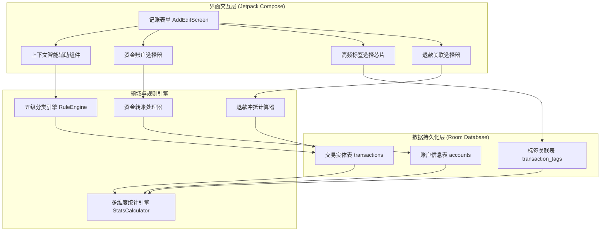

# 基于账单数据分析的软件功能与架构优化设计方案

本文档依据 [账单记录建议.md](file:///D:/github-repository/smart-record/work/analysis/bill-analysis-20261017/%E8%B4%A6%E5%8D%95%E8%AE%B0%E5%BD%95%E5%BB%BA%E8%AE%AE.md) 中的 1964 条历史真实账单分析结论，针对当前轻记账软件在分类体系、备注引导、账户模型、退款关联、标签聚合及统计分析等维度的不足，提供完整的软件层面优化设计。

---

## 一、问题映射与优化目标

| 账单分析发现的问题 | 软件层面的根本原因 | 软件优化目标 |
| :--- | :--- | :--- |
| 收入分类中「其他」占比高达 70.78%（133 笔），且 74.32% 的收入备注为空 | 软件内置收入分类仅有 8 项，缺少家庭资助、兼职劳务、竞赛奖金、平台活动、退税等细分项 | 完善收入多级分类预设体系与自动识别关键词规则 |
| AI Token、云服务、软件订阅分散记录在学费、虚拟充值或其它类目 | 支出分类缺少「软件服务」及其二级分类体系 | 新增「软件服务」一级分类（AI/API、会员订阅、云服务），补齐对应识别规则 |
| 餐饮中 687 条备注仅重复填写「早饭」「午饭」「晚饭」 | 记账界面无动态智能提示，备注输入框未感知当前所选分类 | 当用户选择正餐分类时，输入框占位符动态切换为「填写餐厅名称或外卖平台」，避免重复冗余信息 |
| 单笔金额超过 100 元的 36 笔支出无备注，请客吃饭 16 笔全部无备注 | 记账保存时缺少对大额交易与多人聚餐的轻量化交互提示 | 当金额超过预设阈值或选择聚餐分类时，显示微提示芯片，辅助补充规格型号或分摊人数 |
| 账单中退款字段全部为空，退款只能记为新增收入，导致收支总额虚增 | 数据库模型缺少退款标记与原交易关联指针，导出导入未打通退款字段 | 增加退款交易类型与原交易 ID 关联，统计中计算消费净额 |
| 账户字段全部为空，饭卡充值与食堂消费均计入支出，导致重复计算 | 数据层未构建资金账户实体与账户间转账能力 | 建立资金账户（微信、支付宝、银行卡、校园卡）体系，提供账户转账功能 |
| 标签字段全部为空，旅行（如 8 月出行集中消费）与考试等跨类别消费无法独立汇总 | 记账界面未集成快速标签选择器，缺少标签维度的聚合统计 | 提供高频标签芯片（旅行、驾考、竞赛）与专项下钻统计视图 |

---

## 二、系统架构与数据流图



---

## 三、数据模型扩充方案 (Room Database)

### 1. 交易实体字段扩充

在 [`TransactionEntity.kt`](file:///D:/github-repository/smart-record/app/src/main/java/com/nonen/Bookkeeping/data/db/Entities.kt) 中增加二级分类、资金账户、标签、交易类型及退款关联字段：

```kotlin
package com.nonen.Bookkeeping.data.db

import androidx.room.Entity
import androidx.room.Index
import androidx.room.PrimaryKey

@Entity(
    tableName = "transactions",
    indices = [
        Index("timestamp"),
        Index("category"),
        Index("account"),
        Index("tag"),
        Index(value = ["hash"], unique = true),
    ],
)
data class TransactionEntity(
    @PrimaryKey(autoGenerate = true) val id: Long = 0L,
    /** 金额：正数为收入，负数为支出 */
    val amount: Double,
    /** 一级分类 */
    val category: String,
    /** 二级分类（可选，细化具体用途） */
    val subCategory: String? = null,
    val note: String? = null,
    val merchant: String? = null,
    val timestamp: Long,
    /** 来源：manual / wechat / alipay / auto / excel */
    val source: String,
    /** 资金账户：微信零钱 / 支付宝 / 招商银行 / 校园卡 / 现金 */
    val account: String? = null,
    /** 跨分类项目标签：旅行 / 驾考 / 竞赛 / 课题 */
    val tag: String? = null,
    /** 交易属性：EXPENSE（支出） / INCOME（收入） / TRANSFER（转账） / REFUND（退款） */
    val transactionType: String = if (amount >= 0) "INCOME" else "EXPENSE",
    /** 退款关联的原支出交易 ID，用于计算消费净额 */
    val refundOriginalId: Long? = null,
    /** 转账时的目标账户（仅在 TRANSFER 时有效） */
    val targetAccount: String? = null,
    val rawData: String? = null,
    val hash: String,
    val createdAt: Long = System.currentTimeMillis(),
    val updatedAt: Long = System.currentTimeMillis(),
)
```

### 2. 数据库迁移说明

Room 数据库版本从当前版本自增，编写 `Migration` 脚本执行 `ALTER TABLE transactions ADD COLUMN` 操作，确保原有历史记录安全平稳保留。

---

## 四、分类体系与规则引擎升级

### 1. 分类字典完善

修改 [`Categories.kt`](file:///D:/github-repository/smart-record/app/src/main/java/com/nonen/Bookkeeping/core/Categories.kt)：
- **支出分类**：新增「软件服务」，包含二级分类：`AI/API`、`会员订阅`、`云服务`、`工具软件`。
- **收入分类**：细化为 `家庭支持`、`工资薪金`、`兼职劳务`、`奖学资助`、`人情礼金`、`闲置转让`、`退税退款`、`平台收益`、`理财收益`、`其他收入`。
- **内置规则补全**：
  - 软件服务规则：`DeepSeek`、`Token`、`OpenAI`、`阿里云`、`腾讯云`、`GitHub`、`Cursor`、`ChatGPT`、`云服务器` 映射至「软件服务」。
  - 交通细分修正：`骑行月卡`、`单车月卡`、`美团骑行` 统一归入「交通」并预设二级分类「共享单车」。
  - 学习教育修正：`打印`、`打印费`、`复印` 归入「教育」二级分类「打印资料」；`模拟费`、`驾考` 归入「教育」并标记标签「驾考」。
  - 人情礼物修正：`教师节`、`送花`、`花店` 归入「人情」。
  - 医疗归类修正：`镜架`、`配镜`、`隐形眼镜` 归入「医疗」二级分类「视力矫正」。

---

## 五、界面与交互优化设计 (Jetpack Compose)

### 1. 记账页面智能提示与动态占位符

修改 [`AddEditScreen.kt`](file:///D:/github-repository/smart-record/app/src/main/java/com/nonen/Bookkeeping/ui/screens/AddEditScreen.kt) 与 [`AddEditViewModel.kt`](file:///D:/github-repository/smart-record/app/src/main/java/com/nonen/Bookkeeping/ui/screens/AddEditViewModel.kt)：
1. **备注占位符上下文感知**：
   - 当分类为「餐饮」时，占位符显示为：「输入餐厅名称、商圈或外卖平台」。
   - 当分类为「软件服务」时，占位符显示为：「输入服务商、充值额度或订阅期限」。
   - 当输入「早饭」「午饭」「晚饭」且当前分类已经是餐饮时，展示淡灰色辅助文本，引导录入具体用餐地点。
2. **大额支出与聚餐提示芯片**：
   - 当支出金额达到 100 元且备注为空时，在金额下方平滑展开微型提示卡片：「建议记录商品型号或购买途径，方便后续对账与质保查询」。
   - 当选择「聚餐」「请客」相关分类时，呈现轻量级分摊选择按钮（「个人承担全部」「包含他人代付待收」）。
3. **退款标记与关联弹窗**：
   - 收入方向支持快捷切换为「退款收入」，点击后弹出最近 60 天内的支出流水列表，支持单选关联原交易。关联完成后，自动填充商户名与对应分类，并将退款字段保存入库。
4. **账户与转账功能模块**：
   - 顶部增加第三个模式切换项：「转账」（支出 / 收入 / 转账）。
   - 选择转账模式时，表单呈现「转出账户」与「转入账户」（例如：微信零钱 -> 校园卡）。转账记录不计入消费总额。

---

## 六、23 列标准 Excel 导入与导出完整映射

升级 [`BackupExporter.kt`](file:///D:/github-repository/smart-record/app/src/main/java/com/nonen/Bookkeeping/export/BackupExporter.kt) 与 [`BackupExcelParser.kt`](file:///D:/github-repository/smart-record/app/src/main/java/com/nonen/Bookkeeping/parse/BackupExcelParser.kt)：

1. **导出字段对齐**：
   - 准确导出「二级分类」、「账户」、「退款关联号」、「标签」列。
   - 退款记录在第 8 列（退款）中写入关联的原交易哈希或编号。
2. **导入字段解析**：
   - 读取一木记账 Excel 中的「账户」列并写入 `account` 字段。
   - 读取「标签」列并写入 `tag` 字段。
   - 读取「退款」列，若存在对应原交易哈希，则自动完成退款关系建立。
   - 导入时自动识别「转账」或「卡充值」操作，避免充值和消费出现双重计入。

---

## 七、统计分析与展示维度增强

修改 [`StatsCalculator.kt`](file:///D:/github-repository/smart-record/app/src/main/java/com/nonen/Bookkeeping/stats/StatsCalculator.kt) 与 [`StatisticsScreen.kt`](file:///D:/github-repository/smart-record/app/src/main/java/com/nonen/Bookkeeping/ui/screens/StatisticsScreen.kt)：

1. **退款冲抵净额计算**：
   - 统计面板提供消费总额计算口径切换开关：展示「扣除退款后的实际净支出」与「资金流动总额」。
2. **专项标签下钻透视**：
   - 增加按「标签」维度的消费聚合报表，支持一键查看某次旅行（如 2026 年 8 月旅行）、驾考项目等跨周期的全项成本。
3. **离群大额过滤分析**：
   - 在月度趋势与日均消费统计中，支持勾选「排除单笔异常大额消费」，让日常平稳开销走势更加真实可靠。
