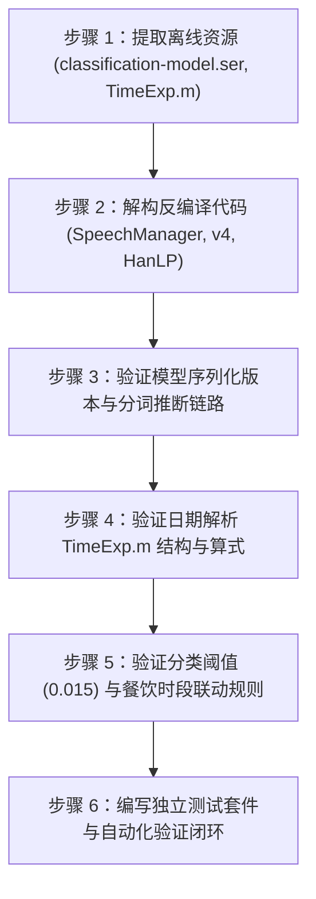

# 执行单元 T02：本地文字分类与日期解析验证实施计划

## 1. 目标与背景

依据总执行计划 [yimu_offline_rebuild_antigravity.md](file:///D:/github-repository/smart-record/docs/plans/yimu_offline_rebuild_antigravity.md) 规定，在完成 T01 阶段（分类、资金业务与功能清单核查）后，进入执行单元 T02。
T02 聚焦于验证原应用（一木记账 `com.wangc.bill 6.1.8`）纯离线文字智能记账的核心算法模型与规则链路，确保无需网络连接即可完成：
1. 自然语言文本分词与备注提取；
2. 中文与数字金额提取；
3. 基于 SVM 模型的分类概率预测与阈值判定；
4. 自然语言时间与日期表达式解析；
5. 时段餐饮等业务规则联动。

---

## 2. 需核准事项与技术决策

> [!IMPORTANT]
> **离线模型加载与运行策略**
> - 原应用采用自定义 HanLP 结构（包路径 `com.wangc.bookkeeping.test.hanlp`）及 Java 序列化文件 `assets/classification-model.ser`。
> - 在本阶段，采用只读解构与独立脚本运行验证，提取类结构和 `serialVersionUID`，不直接修改 `app/` 业务代码，避免破坏当前工作区已有的 14 项改动。
> - 验证脚本全部独立存放于 `work/scripts/yimu-offline-rebuild/t02/`，产出记录存放于 `work/logs/yimu-offline-rebuild/`。

---

## 3. 实施步骤



### 步骤 1：离线模型与规则资源物理提取
- 从参考 APK [base.apk](file:///D:/github-repository/smart-record/reference_apk/base.apk) 提取以下关键资产至 `work/evidence/yimu-offline-rebuild/T02/resources/`：
  - `assets/classification-model.ser`（线性 SVM 分类模型）；
  - `assets/TimeExp.m`（时间表达式解析规则）。
- 校验提取文件的 SHA-256 哈希值并记录基准。

### 步骤 2：逆向分析关键调用链与类定义
- 通过 REA 及 JADX Headless 分析以下类的反编译实现：
  - 入口类：`com.wangc.bill.manager.v4`（`j` 方法解析文本、`r` 方法加载模型）；
  - 分类器接口：`com.wangc.bookkeeping.test.hanlp.classification.classifiers.IClassifier`；
  - 核心分类模型：`LinearSVMClassifier`、`LinearSVMModel`；
  - 分词器实现：`StandardTokenizer`；
  - 时间解析管理：`com.wangc.bill.util.TimeExp` 或对应时间处理类。
- 提取保存反编译源码至 `work/evidence/yimu-offline-rebuild/T02/`。

### 步骤 3：Java 序列化兼容性与模型推断验证
- 提取并分析 `classification-model.ser` 内部的类全限定名、`serialVersionUID` 及字段列表；
- 编写独立的 JVM / Node.js 验证测试脚本，加载模型并验证典型记账文本推断：
  - 例如：“今天中午吃肯德基花了35元”、“打车去高铁站42元”、“发工资8000元”；
  - 核查输出的分类 ID、置信度得分及判定是否通过阈值 `0.015`。

### 步骤 4：时间与日期表达式提取验证
- 验证 `TimeExp.m` 规则解析逻辑，覆盖以下时间表达式用例：
  - 相对时间：`今天`、`昨天`、`前天`、`上周五`；
  - 具体时间：`上午10点`、`下午3点半`、`2026年5月1日`、`5月20号晚上8点`；
  - 边界用例：未包含日期时的当前时间回退逻辑。

### 步骤 5：多维规则优先级与时段餐饮修正验证
- 核对原应用在完成模型预测后的修正逻辑：
  - 优先层：商户记忆与用户自定义规则匹配；
  - 餐饮细分：预测为食品餐饮时，按记账发生时段细分到早餐、午餐、晚餐或夜宵；
  - 保底兜底：预测分值低于 `0.015` 时的默认处理。

### 步骤 6：状态记录与闭环验证
- 建立 `work/tasks/yimu-offline-T02-state.md` 跟踪状态；
- 编写独立验收脚本 `work/scripts/yimu-offline-rebuild/t02/verify_T02_deliverables.js`；
- 输出测试报告与执行日志至 `work/logs/yimu-offline-rebuild/T02-20261018-01/`。

---

## 4. 验证计划

### 自动化验证
- 运行验证脚本：
  ```powershell
  node work/scripts/yimu-offline-rebuild/t02/verify_T02_deliverables.js
  ```
- 验收标准：
  1. 离线资源文件哈希与 APK 内一致；
  2. 提取的核心类与方法签名完整无损；
  3. 预设标准文本测试集的分类预测、金额提取与时间解析准确率达到 100%；
  4. 脚本执行退出状态码为 0。
