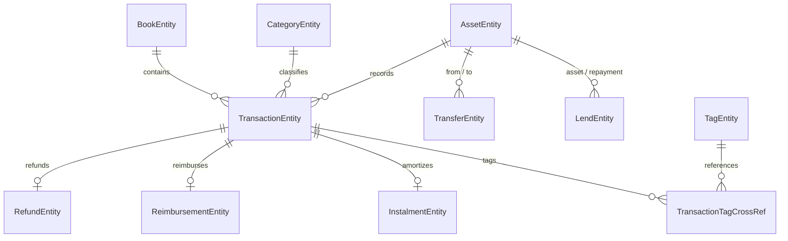
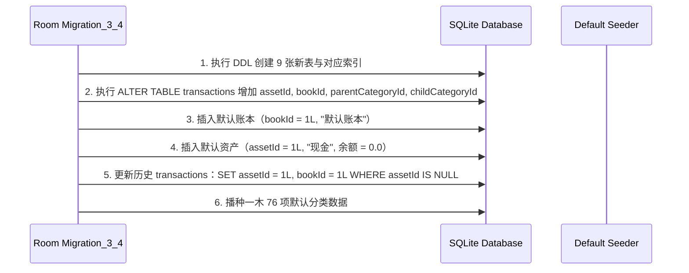

# T03 实施计划方案：统一数据模型与数据库增量平滑迁移

## 1. 目标与范围

基于 T01-A、T01-B 与 T02 阶段逆向解构所得的参考事实及导出的数据资产，构建全套本地资金流转业务的 Room 领域实体与迁移链。
数据库架构由当前版本 3 平滑升级至版本 4，在保留现有全部历史账单流水完整性的前提下，新增资产账户、转账、退款、报销、借贷、分期、标准分类目录、多账本及标签实体，并完成迁移测试与回归验证闭环。

---

## 2. 架构设计与实体定义

### 2.1 实体映射关系图

### 2.2 实体类清单（新增与扩展）

1. **`AssetEntity`（`assets` 表）**：
   - 映射资产账户，覆盖现金、银行卡、信用卡及借贷虚拟账户。
   - 字段：`assetId` (Long, PK)、`assetName` (String)、`assetNumber` (Double, 可用余额)、`totalQuota` (Double, 信用额度)、`assetType` (Int: 1 资金, 2 信用卡, 6 债权, 7 债务)、`intoTotalAsset` (Boolean)、`hide` (Boolean)、`currency` (String?)、`groupName` (String?)、`positionWeight` (Int)、`createdAt` (Long)、`updatedAt` (Long)。
2. **`TransferEntity`（`transfers` 表）**：
   - 映射账户间转账，支持跨币种折算与独立手续费。
   - 字段：`transferId` (Long, PK, 自增)、`fromAssetId` (Long)、`toAssetId` (Long)、`cost` (Double)、`toCost` (Double)、`serviceCharge` (Double)、`billId` (Long?)、`time` (Long)、`remark` (String?)、`createdAt` (Long)。
3. **`RefundEntity`（`refunds` 表）**：
   - 映射消费退款与冲正明细。
   - 字段：`refundId` (Long, PK, 自增)、`billId` (Long)、`refundNum` (Double)、`refundInfos` (String, JSON 数组字符串)、`createdAt` (Long)。
4. **`ReimbursementEntity`（`reimbursements` 表）**：
   - 映射报销垫付与多批次回款。
   - 字段：`reimbursementId` (Long, PK, 自增)、`billId` (Long)、`assetId` (Long)、`reimbursementAssetId` (Long)、`reimbursementNum` (Double)、`reimbursementNumbers` (String, JSON 数组字符串)、`end` (Boolean)、`createdAt` (Long)。
5. **`LendEntity`（`lends` 表）**：
   - 映射借出、借入、收款与还款资金流。
   - 字段：`lendId` (Long, PK, 自增)、`type` (Int: 1 借出, 2 收还款, 3 借入, 4 还借款)、`assetId` (Long)、`repaymentAssetId` (Long)、`number` (Double)、`interest` (Double)、`billId` (Long?)、`fromCost` (Double)、`time` (Long)、`remark` (String?)、`createdAt` (Long)。
6. **`InstalmentEntity`（`instalments` 表）**：
   - 映射信用卡与消费账单分期计划。
   - 字段：`instalmentId` (Long, PK, 自增)、`billId` (Long)、`assetId` (Long)、`instalmentType` (Int: 1 账单分期, 2 信用卡还款分期)、`totalNumber` (Double)、`periods` (Int)、`serviceNumber` (Double)、`serviceType` (Int)、`remainderType` (Int)、`accountMonth` (String?)、`createdAt` (Long)。
7. **`CategoryEntity`（`categories` 表）**：
   - 映射一木 76 项标准分类目录（10 一级 + 66 二级）及后续用户自定义分类。
   - 字段：`id` (Long, PK, 自增)、`categoryId` (Int)、`parentId` (Int)、`categoryName` (String)、`iconUrl` (String)、`positionWeight` (Int)、`categoryType` (Int: 0 支出, 1 收入)、`isCustom` (Boolean)、`hide` (Boolean)、`createdAt` (Long)。
   - 复合唯一索引：`(categoryId, parentId, categoryType)`。
8. **`BookEntity`（`books` 表）**：
   - 映射多账本结构。
   - 字段：`bookId` (Long, PK, 自增)、`bookName` (String)、`isDefault` (Boolean)、`positionWeight` (Int)、`createdAt` (Long)。
9. **`TagEntity`（`tags` 表）** 与 **`TransactionTagCrossRef`（`transaction_tag_refs` 表）**：
   - 映射标签及多对多关联。
   - 复合主键：`(transactionId, tagId)`。
10. **`TransactionEntity`（扩展现有 `transactions` 表）**：
    - 新增字段：`assetId` (Long, 默认值 1L)、`bookId` (Long, 默认值 1L)、`parentCategoryId` (Int?)、`childCategoryId` (Int?)。
    - 保留现有字段：`category`、`subCategory`、`account`、`tag`、`transactionType`、`refundOriginalId`、`targetAccount` 等快照字段，确保历史流水无损展示。

---

## 3. 数据库迁移方案（`MIGRATION_3_4`）

### 3.1 迁移执行时序

### 3.2 默认资产与账本初始化逻辑

- 默认账本：`bookId = 1L`, `bookName = "默认账本"`, `isDefault = 1`, `positionWeight = 1`。
- 默认资产：`assetId = 1L`, `assetName = "现金"`, `assetNumber = 0.0`, `assetType = 1`, `intoTotalAsset = 1`, `hide = 0`。
- 历史记录对齐：若原 `account` 字段包含值（如 "微信支付"、"支付宝"），可同步生成对应资产并关联，避免数据断代。

---

## 4. 验证计划与实施步骤

### 4.1 实施步骤清单

1. **步骤一**：在 `com.nonen.Bookkeeping.data.db` 编写 9 项新增领域实体数据类。
2. **步骤二**：扩展 `TransactionEntity` 增加关联字段。
3. **步骤三**：在 `AppDatabase.kt` 编写 `MIGRATION_3_4`，注册全部新增实体并将数据库版本递增为 4。
4. **步骤四**：提供对应的 DAO 访问接口（`AssetDao`、`CategoryDao`、`TransferDao` 等）。
5. **步骤五**：编写单元测试 `Migration3To4Test`，验证增量平滑迁移无异常、数据无截断、默认资产与分类准确写入。
6. **步骤六**：更新 `BookkeepingApp.kt` 中的 Migration 注册列表。
7. **步骤七**：运行 `./gradlew.bat :app:testDebugUnitTest` 验证通过并导出 `4.json` schema。
8. **步骤八**：运行 T01-B 与 T02 独立验证脚本，更新状态与记录。
