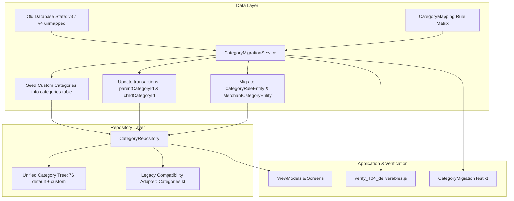

# T04 实施方案：完成历史分类映射与分类管理迁移

## 1. 目标与背景

在 T03（统一数据模型与数据库增量平滑迁移）中，已在 Room 数据库中构建包含 13 个实体表、版本 4 数据库架构，并播种了一木记账 76 项默认分类（10 个一级分类 + 66 个二级分类）。

本阶段（T04）的核心目标是建立**历史分类与一木分类体系的确定性双向映射表**，实现历史账单、分类规则与商户记忆的数据平滑迁移，确保：
1. 每一项能够唯一对应的历史分类准确转换至对应一木分类；
2. 存在多重含义或无法唯一对应的分类完整保留为自定义分类（`isCustom = true`）；
3. 历史账单的交易数量、金额、时间、去重哈希、商户与备注等物理字段 100% 守恒无损；
4. 迁移过程具备严格的幂等性（重复触发不会产生重复数据或脏数据）；
5. 建立统一的分类数据仓库层（`CategoryRepository`），为 T05（分类管理与记账闭环）提供稳健支撑。

---

## 2. 映射矩阵与迁移规则

依据 `docs/plans/yimu_offline_rebuild_antigravity.md` 第 9 节的固定迁移规则制定如下确定性映射矩阵：

### 2.1 支出一级分类映射

| 旧支出分类 | 一木一级分类 (ID) | 映射策略 | 详细说明 |
|---|---|---|---|
| 餐饮 | 食品餐饮 (7) | 唯一对应 | 归入食品餐饮一级；若无二级分类，则 `childCategoryId = null` |
| 交通 | 出行交通 (6) | 唯一对应 | 归入出行交通一级；若无二级分类，则 `childCategoryId = null` |
| 购物 | 购物消费 (8) | 唯一对应 | 仅归入购物消费一级，`childCategoryId = null`；严禁自动随机分配给某一具体商品子类 |
| 居住 | 居家生活 (4) | 唯一对应 | 归入居家生活一级；若无二级分类，则 `childCategoryId = null` |
| 娱乐 | 休闲娱乐 (5) | 唯一对应 | 归入休闲娱乐一级；若无二级分类，则 `childCategoryId = null` |
| 医疗 | 健康医疗 (1) | 唯一对应 | 归入健康医疗一级；若无二级分类，则 `childCategoryId = null` |
| 教育 | 文化教育 (3) | 唯一对应 | 归入文化教育一级；若无二级分类，则 `childCategoryId = null` |
| 人情 | 送礼人情 (2) | 唯一对应 | 归入送礼人情一级；若无二级分类，则 `childCategoryId = null` |
| 其他 | 其他 (99) | 唯一对应 | 归入其他一级；`childCategoryId = null` |
| 旅行 | 休闲娱乐 (5) | 细化归属 | 唯一对应一木二级分类 507 (`旅游度假`)，父级为 5 |
| 通讯 | 居家生活 (4) | 细化归属 | 唯一对应一木二级分类 408 (`话费宽带`)，父级为 4 |
| 宠物 | 购物消费 (8) | 细化归属 | 唯一对应一木二级分类 803 (`宠物用品`)，父级为 8 |
| 母婴 | 购物消费 (8) | 细化归属 | 唯一对应一木二级分类 805 (`母婴玩具`)，父级为 8 |
| 金融 | 其他 (99) | 细化归属 | 唯一对应一木二级分类 9902 (`理财支出`)，父级为 99 |
| 服饰美容 | 购物消费 (8) | 自定义子类 | 包含服饰(804)与美妆(810)，无法唯一对应，在一级 8 下保留为自定义二级分类（`isCustom = true`） |
| 软件服务 | 软件服务 (自定义) | 自定义一级 | 一木 76 项中无对应一级，完整保留为自定义一级分类（`isCustom = true`） |

### 2.2 支出历史二级分类映射

| 旧二级分类 | 所属旧分类 | 一木一级 (ID) | 一木二级 (ID) | 映射策略与说明 |
|---|---|---|---|---|
| 早餐 | 餐饮 | 食品餐饮 (7) | 早餐 (708) | 唯一对应 |
| 午餐 | 餐饮 | 食品餐饮 (7) | 午餐 (707) | 唯一对应 |
| 晚餐 | 餐饮 | 食品餐饮 (7) | 晚餐 (706) | 唯一对应 |
| 饮品零食 | 餐饮 | 食品餐饮 (7) | 饮品零食 (自定义) | 对应零食(704)与酒水(705)，无法唯一对应，保留为自定义二级分类 |
| 聚餐外卖 | 餐饮 | 食品餐饮 (7) | 聚餐外卖 (自定义) | 无法唯一确定单项，保留为自定义二级分类 |
| 打车 | 交通 | 出行交通 (6) | 打车 (607) | 唯一对应 |
| 公交地铁 | 交通 | 出行交通 (6) | 公共交通 (606) | 唯一对应 |
| 共享单车 | 交通 | 出行交通 (6) | 共享单车 (自定义) | 保留为出行交通下的自定义二级分类 |
| 火车机票 | 交通 | 出行交通 (6) | 火车机票 (自定义) | 包含火车(603)与飞机(602)，保留为自定义二级分类 |
| 日常买药 | 医疗 | 健康医疗 (1) | 买药 (101) | 唯一对应 |
| 常规就医 | 医疗 | 健康医疗 (1) | 医院 (102) | 唯一对应 |
| 视力矫正 | 医疗 | 健康医疗 (1) | 视力矫正 (自定义) | 保留为健康医疗下的自定义二级分类 |
| 培训考试 | 教育 | 文化教育 (3) | 培训考试 (301) | 唯一对应 |
| 学杂费 | 教育 | 文化教育 (3) | 学费 (303) | 唯一对应 |
| 教材书籍 | 教育 | 文化教育 (3) | 书报杂志 (302) | 唯一对应 |
| 打印资料 | 教育 | 文化教育 (3) | 打印资料 (自定义) | 保留为文化教育下的自定义二级分类 |
| 红包 | 人情 | 送礼人情 (2) | 红包 (202) | 唯一对应 |
| 礼物 | 人情 | 送礼人情 (2) | 礼物 (204) | 唯一对应 |
| 请客 | 人情 | 送礼人情 (2) | 请客 (自定义) | 保留为送礼人情下的自定义二级分类 |
| 份子钱 | 人情 | 送礼人情 (2) | 份子钱 (自定义) | 保留为送礼人情下的自定义二级分类 |
| AI/API | 软件服务 | 软件服务 (自定义) | AI/API (自定义) | 保留为自定义二级分类 |
| 会员订阅 | 软件服务 | 软件服务 (自定义) | 会员订阅 (自定义) | 保留为自定义二级分类 |
| 云服务 | 软件服务 | 软件服务 (自定义) | 云服务 (自定义) | 保留为自定义二级分类 |
| 工具软件 | 软件服务 | 软件服务 (自定义) | 工具软件 (自定义) | 保留为自定义二级分类 |

### 2.3 收入分类映射

所有历史收入分类均归属一木一级 9 (`收入`，`categoryType = 1`)：

| 旧收入分类 | 一木二级分类 (ID) | 映射策略 | 详细说明 |
|---|---|---|---|
| 工资 | 工资 (904) | 唯一对应 | 一木收入 904 |
| 兼职 | 兼职外快 (905) | 唯一对应 | 一木收入 905 |
| 理财 | 理财盈利 (909) | 唯一对应 | 一木收入 909 |
| 闲置出售 | 二手闲置 (903) | 唯一对应 | 一木收入 903 |
| 红包 | 礼金人情 (908) | 唯一对应 | 一木收入 908 |
| 奖学金 | 奖金 (906) | 唯一对应 | 一木收入 906 |
| 其他收入 | 其他 (911) | 唯一对应 | 一木收入 911 |
| 生活费 | 生活费 (自定义) | 自定义子类 | 一木无对应单项，保留为自定义二级分类，保留非劳动收入原意 |
| 平台收益 | 平台收益 (自定义) | 自定义子类 | 无法唯一对应，保留为自定义二级分类 |
| 退税 | 退税 (自定义) | 自定义子类 | 保留为自定义二级分类 |
| 退款 | 退款 (自定义) | 自定义子类 | 严格遵守业务证据规则，不凭借分类名称改变交易性质 |

---

## 3. 架构设计与实现方案

### 3.1 核心组件划分

1. **`CategoryMapping.kt`**：
   - 包含旧分类至一木体系的完整映射字典与查找工具；
   - 提供输入 `(category: String, subCategory: String?, isIncome: Boolean)` 输出 `TargetCategoryMapping(parentId, childId, parentName, childName, isCustom)` 的确定性方法。

2. **`CategoryMigrationService.kt`**：
   - 执行实际的数据迁移与自愈：
     - 查询数据库中尚未关联分类 ID 的账单；
     - 注入所需的自定义分类；
     - 批量更新 `transactions` 关联字段；
     - 校验迁移后记录数、金额与哈希一致性；
     - 提供幂等保障（多次调用只处理未迁移记录，无冗余修改）。

3. **`CategoryRepository.kt`**：
   - 统一管理所有分类实体与层级树；
   - 提供按收支类型查询一级分类、按父级查询二级分类的清晰接口；
   - 支持自定义分类的增删改查。

4. **`Categories.kt` 兼容层改造**：
   - 保留原有常量与工具方法，增加指向新分类体系的过渡方法，杜绝编译中断或破坏未提交的历史文件。

---

## 4. 实施计划步骤

### 步骤 1：构建分类映射模型与核心逻辑
- 编写 `app/src/main/java/com/nonen/Bookkeeping/core/CategoryMapping.kt`，包含完整映射表及解析规则。

### 步骤 2：实现分类迁移服务与数据访问层
- 编写 `app/src/main/java/com/nonen/Bookkeeping/data/repo/CategoryRepository.kt`；
- 编写 `app/src/main/java/com/nonen/Bookkeeping/data/migration/CategoryMigrationService.kt`；
- 在 `BookkeepingApp.kt` 注册迁移触发点与仓库依赖。

### 步骤 3：编写自动化测试与独立核验脚本
- 编写 JVM 单元测试 `app/src/test/java/com/nonen/Bookkeeping/data/migration/CategoryMigrationTest.kt`；
- 编写 Node.js 独立验收脚本 `work/scripts/yimu-offline-rebuild/t04/verify_T04_deliverables.js`，通过真实 SQLite 演练并验证包含 16 种支出与 11 种收入场景的历史数据全量迁移。

### 步骤 4：闭环验证与状态记录
- 运行 `node work/scripts/yimu-offline-rebuild/t04/verify_T04_deliverables.js` 验证迁移结果；
- 运行 `./gradlew.bat :app:testDebugUnitTest :app:lintDebug` 验证全量单元测试与构建；
- 运行前序 T01-B、T02、T03 验收脚本保证无回归；
- 更新 `work/tasks/yimu-offline-T04-state.md` 与 `work/tasks/yimu-offline-rebuild.md`；
- 更新 `HANDOFF.md` 为 S04 阶段交接准备。

---

## 5. 验证标准

1. **映射准确性**：
   - 27 项旧分类（16 支出 + 11 收入）及 24 项旧二级分类均具有明确映射去向；
   - 无法唯一映射的项全部安全转为 `isCustom = true` 的分类。
2. **数据完整性**：
   - 历史账单迁移前后数量、总金额、时间、去重哈希、商户、备注 100% 保持一致；
   - 规则表与商户记忆表保持有效关联。
3. **幂等性与健壮性**：
   - 连续执行两次迁移服务，分类表不增加多余行，账单无二次变更。
4. **测试命令**：
   - `node work/scripts/yimu-offline-rebuild/t04/verify_T04_deliverables.js` 退出状态为 0；
   - `.\gradlew.bat :app:testDebugUnitTest :app:lintDebug` 退出状态为 0。
