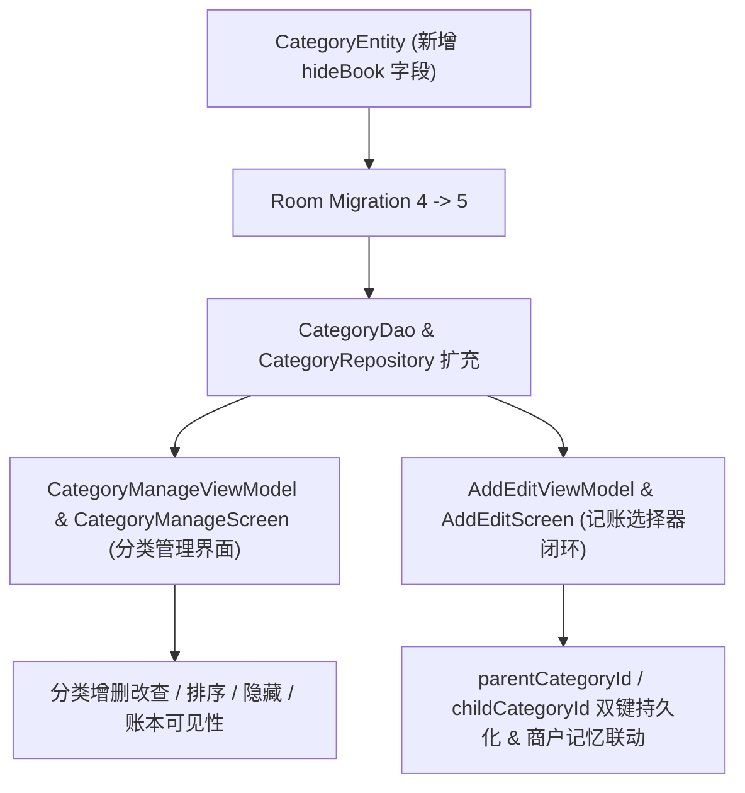

# T05 分类管理与记账闭环实施计划

## 1. 目标说明

在已完成的 T04 历史分类映射与分类数据仓库基础之上，全面实现一木记账 6.1.8 规格的收支分类管理体系与记账编辑闭环（执行单元 T05）：
1. **分类模型与账本可见性扩展**：在 `CategoryEntity` 中增加 `hideBook` 字段（记录分类被隐藏的账本 ID 列表），数据库平滑升级至版本 5，保持数据库迁移链连续完整。
2. **分类管理功能闭环**：提供支出/收入双 Tab 分类管理界面，支持一级与二级分类的新增、编辑（名称/图标）、全局隐藏、单账本可见性设置、排序调整以及自定义分类安全删除校验。
3. **记账选择器与数据持久化联动**：改造记账界面（`AddEditScreen`），实现基于真实数据仓库的二级级联分类选择、收支切换保护、分类切换清理、手动选择锁定与智能速记关联，保存时同时持久化 `parentCategoryId` 与 `childCategoryId` 外键引用并更新商户记忆。
4. **全链路验证与回归保障**：补充单元测试与自动化综合验收脚本，保证数据守恒、迁移幂等以及全量既有测试通过。

---

## 2. 关键设计与审查确认项

1. **数据库版本升级至 Version 5**：为了完整支持《总体规划》第 8 节与第 10 节要求的“账本内分类可见性（`hideBook`）”，需为 `categories` 表添加 `hideBook` 字段并提供 `MIGRATION_4_5`，导出 Room `5.json` schema。此操作保持现有历史数据无损并向前兼容。
2. **分类安全删除策略**：系统预设的 76 项默认分类禁止物理删除，仅允许隐藏；用户自定义分类（`isCustom = true`）执行删除时，若已有关联账单引用该分类，界面弹出安全提示并提供选项：直接改为隐藏，或将历史账单保留名称文本快照并将分类外键重置为 0，防止破坏历史记账记录。

---

## 3. 架构关系



---

## 4. 具体变更清单

### 4.1 数据持久化层（Database & Entities）

#### [MODIFY] `app/src/main/java/com/nonen/Bookkeeping/data/db/CategoryEntity.kt`
- 增加 `hideBook: String? = null` 属性；
- 增加账本可见性辅助解析函数：`fun isHiddenInBook(bookId: Long): Boolean` 与 `fun toggleBookHidden(bookId: Long): CategoryEntity`。

#### [MODIFY] `app/src/main/java/com/nonen/Bookkeeping/data/db/AppDatabase.kt`
- 数据库注解版本更新为 `version = 5`；
- 编写并注册 `MIGRATION_4_5`：
  ```kotlin
  val MIGRATION_4_5 = object : Migration(4, 5) {
      override fun migrate(db: SupportSQLiteDatabase) {
          db.execSQL("ALTER TABLE `categories` ADD COLUMN `hideBook` TEXT DEFAULT NULL")
      }
  }
  ```

#### [NEW] `app/schemas/com.nonen.Bookkeeping.data.db.AppDatabase/5.json`
- 导出包含 `hideBook` 字段的完整 Room version 5 结构定义。

#### [MODIFY] `app/src/main/java/com/nonen/Bookkeeping/data/db/CategoryDao.kt`
- 增加按收支类型与父级实时观察分类列表的 Flow 查询；
- 增加账单引用安全校验查询与分类清理方法。

### 4.2 领域与仓库层（Repository & Domain）

#### [MODIFY] `app/src/main/java/com/nonen/Bookkeeping/data/repo/CategoryRepository.kt`
- 暴露观察指定类型分类树的 Flow 响应源；
- 提供分类排序权重更新方法；
- 提供全局显示隐藏切换与账本可见性切换；
- 提供自定义分类创建与安全删除校验方法。

### 4.3 界面交互层（UI & Screens）

#### [NEW] `app/src/main/java/com/nonen/Bookkeeping/ui/screens/CategoryManageViewModel.kt`
- 维护支出/收入 Tab 状态；
- 读取分类树并提供分类管理全部业务动作；
- 提供删除前引用检查。

#### [NEW] `app/src/main/java/com/nonen/Bookkeeping/ui/screens/CategoryManageScreen.kt`
- 遵循 Material 3 与沉浸式视觉规范构建：
  - 双 Tab 分类切换；
  - 一级与二级分类卡片与展开列表；
  - 隐藏切换、排序移动、编辑与删除；
  - 图标选取与自定义分类创建对话框。

#### [MODIFY] `app/src/main/java/com/nonen/Bookkeeping/ui/screens/AddEditViewModel.kt`
- 注入 `CategoryRepository`；
- 维护选中的 `parentCategoryId` 与 `childCategoryId`；
- 切换一级分类时级联重置二级分类；
- 保存时写入双分类外键并更新商户记忆。

#### [MODIFY] `app/src/main/java/com/nonen/Bookkeeping/ui/screens/AddEditScreen.kt`
- 升级为二级级联分类选择器；
- 标题栏右侧增加进入分类管理的快捷按钮。

#### [MODIFY] `app/src/main/java/com/nonen/Bookkeeping/ui/AppNavHost.kt` 与 `app/src/main/java/com/nonen/Bookkeeping/ui/screens/SettingsScreen.kt`
- 注册 `Routes.CATEGORY_MANAGE` 路由并配置平滑转场与设置页入口。

---

## 5. 验证方案

1. **Room 迁移测试**：编写并运行 `Migration4To5Test`，验证升级无损；
2. **分类管理业务测试**：编写并运行 `CategoryManageTest.kt`；
3. **独立综合验收脚本**：编写 `work/scripts/yimu-offline-rebuild/t05/verify_T05_deliverables.js` 真实 SQLite 演练；
4. **编译与静态检查**：运行 `.\gradlew.bat :app:testDebugUnitTest :app:lintDebug`。
