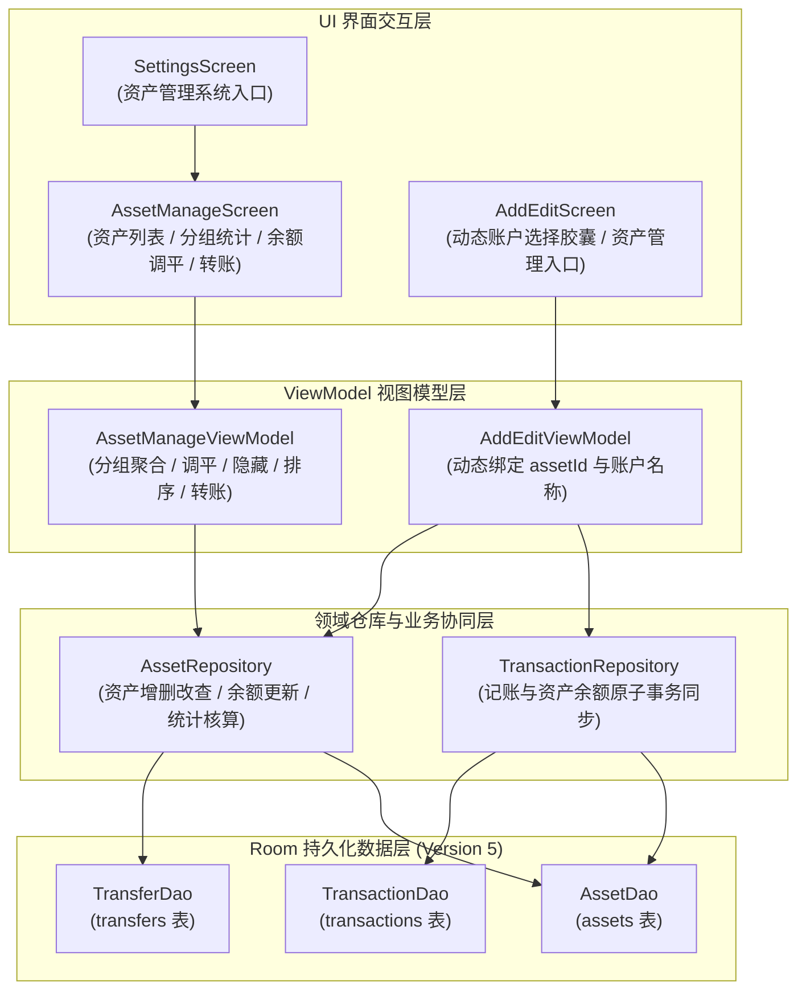

# T06 资产与账户管理实施计划方案

## 1. 目标描述与背景

### 1.1 阶段目标
在已完成的统一数据模型（Room 版本 5）与分类管理闭环（T05）基础之上，完整实现执行单元 **T06：完成资产与账户管理**。
构建专职资产数据仓库（`AssetRepository`）、资金流转业务协同机制（记账与转账余额原子同步）、资产管理视图模型（`AssetManageViewModel`）以及资产管理界面（`AssetManageScreen`）。打通从记账页动态选择账户到资产账户列表管理、分组展示、净资产/总负债统计、余额调平及资金转账的全链路闭环。

### 1.2 背景与物理基准
- **数据库基础**：Room 数据库版本 5 中已建立 `assets`（资产表）与 `transfers`（转账表）独立物理表，在 `MIGRATION_3_4` 与 `BookkeepingApp.kt` 初始化中已内置默认资产（`assetId = 1`，现金账户）；
- **业务依据**：遵循 `work/reports/yimu-offline-rebuild/T01-B-financial.md` 与 `work/evidence/yimu-offline-rebuild/T01/financial/financial-reference.json` 中核对的业务状态机与数学公式；
- **长期关键决策遵守**：维持独立实体表架构、`Double` 存储精度、增量平滑迁移、排除房贷车贷业务等决策。

---

## 2. 架构设计与状态机模型



### 2.1 资产余额变动与业务状态机公式

1. **记账收支联动公式**（与 `TransactionRepository` 协同）：
   - **新增支出**：目标资产可用余额扣减 $\Delta Asset = - \text{Math.abs}(Cost)$；
   - **新增收入**：目标资产可用余额增加 $\Delta Asset = + \text{Math.abs}(Cost)$；
   - **修改账单**：先对冲回滚原账单对旧资产的影响，再对新资产应用新账单影响：
     $$\text{Old Rollback} = \begin{cases} - \text{Math.abs}(OldCost), & \text{若原记录为收入} \\ + \text{Math.abs}(OldCost), & \text{若原记录为支出} \end{cases}$$
     $$\text{New Apply} = \begin{cases} + \text{Math.abs}(NewCost), & \text{若新记录为收入} \\ - \text{Math.abs}(NewCost), & \text{若新记录为支出} \end{cases}$$
   - **删除账单**：执行反向回滚对冲。
2. **转账业务公式**（`TransferEntity`）：
   - 调出账户（`fromAssetId`）：扣减转出金额及手续费 $\Delta FromAsset = - (\text{cost} + \text{serviceCharge})$；
   - 调入账户（`toAssetId`）：增加实际到账金额 $\Delta ToAsset = + \text{toCost}$；
   - 手续费独立入账：若 $\text{serviceCharge} > 0$，联动生成一笔手续费支出账单（`billType = 1`，`cost = serviceCharge`，`assetId = fromAssetId`）；
   - 撤销/删除转账：调出账户加回 $\text{cost} + \text{serviceCharge}$，调入账户扣除 $\text{toCost}$，清理手续费关联账单。
3. **资产净值统计公式**（`AssetSummary`）：
   - **总资产（Total Assets）**：纳入总资产核算（`intoTotalAsset == true`）且余额为正的资产账户余额总和；
   - **总负债（Total Liabilities）**：所有负债账户（信用卡已用额度、债务借入账户，或纳入统计但余额为负）的绝对值总和；
   - **净资产（Net Assets）**：$\text{Net Assets} = \text{Total Assets} - \text{Total Liabilities}$。
4. **余额调平公式**（`AdjustBalance`）：
   - 计算差额：$\text{Delta} = \text{TargetBalance} - \text{CurrentBalance}$；
   - 更新资产余额为目标值 $\text{TargetBalance}$；
   - 若勾选“生成平账账单”：若 $\text{Delta} > 0$ 生成一笔收入（分类“其他收入”，备注“余额调平盘盈”），若 $\text{Delta} < 0$ 生成一笔支出（分类“其他支出”，备注“余额调平盘亏”）。

---

## 3. 拟变更文件清单与实施细节

### 3.1 领域与数据访问层

#### [MODIFY] `FinancialDaos.kt`
- 扩充 `AssetDao`：
  - `getAllFlow(): Flow<List<AssetEntity>>`：观察全量资产（含隐藏资产，供管理界面查看与切换）；
  - `getMaxAssetId(): Long?`：安全分配自定义账户的全局唯一自增 ID；
  - `getMaxPositionWeight(): Int?`：新增账户排在末尾；
  - `countTransactionsUsingAsset(assetId: Long): Int`：查询使用该资产的账单记录数；
  - `countTransfersUsingAsset(assetId: Long): Int`：查询使用该资产的转账记录数；
  - `updateAssetHide(assetId: Long, hide: Boolean)`：切换隐藏状态；
  - `updatePositionWeight(assetId: Long, weight: Int)`：支持账户上下调序；
- 扩充 `TransferDao`：
  - `deleteById(transferId: Long)`：按 ID 删除转账记录；
  - `getByAssetId(assetId: Long): List<TransferEntity>`：查询某账户的关联转账。

#### [NEW] `AssetRepository.kt`
- 职责：集中管理资产账户增删改查、排序、隐藏、余额调平与资金统计；
- 核心方法：
  - `observeAll(): Flow<List<AssetEntity>>`
  - `observeVisible(): Flow<List<AssetEntity>>`
  - `getById(assetId: Long): AssetEntity?`
  - `calculateSummary(assets: List<AssetEntity>): AssetSummary`
  - `createAsset(name: String, initialBalance: Double, quota: Double, type: Int, groupName: String?, intoTotalAsset: Boolean): Long`
  - `updateAsset(asset: AssetEntity)`
  - `adjustBalance(assetId: Long, targetBalance: Double, createAdjustmentBill: Boolean, note: String?)`
  - `toggleHide(assetId: Long)`
  - `reorderAssets(orderedIds: List<Long>)`
  - `deleteAsset(assetId: Long): Boolean`（默认现金账户 `assetId = 1` 禁止删除；存在关联记录时安全迁移至默认账户）。

#### [MODIFY] `TransactionRepository.kt`
- 构造参数接入 `assetDao: AssetDao? = null` 与 `transferDao: TransferDao? = null` 支持可选注入；
- 记账新增、编辑、删除时，执行对应账户可用余额的原子更新；
- 提供转账业务方法：
  - `createTransfer(fromAssetId: Long, toAssetId: Long, cost: Double, toCost: Double, fee: Double, time: Long, remark: String?): Long`
  - `deleteTransfer(transferId: Long)`。

#### [MODIFY] `BookkeepingApp.kt`
- 在 `AppContainer` 中实例化并暴露 `val assetRepository = AssetRepository(assetDao, transferDao, transactionDao, database)`；
- 传递 `assetDao` 至 `transactionRepository`。

---

### 3.2 表现层与交互闭环

#### [NEW] `AssetManageViewModel.kt`
- 状态驱动：
  - `assets`: 实时资产列表（`StateFlow<List<AssetEntity>>`）；
  - `summary`: 实时聚合统计数据（`StateFlow<AssetSummary>`，含净资产、总资产、总负债）；
  - `groupedAssets`: 按账户类型（资金账户、信用卡账户、借贷账户）或分组名称聚合映射；
  - `showHidden`: 是否显示隐藏账户开关；
  - 弹窗控制：新增/编辑资产弹窗、余额调平弹窗、转账弹窗、安全删除提示弹窗；
- 构造函数提供 `externalScope: CoroutineScope? = null` 满足纯 JVM 单元测试调度隔离。

#### [NEW] `AssetManageScreen.kt`
- 界面组件构成（Material 3 规范）：
  - 顶部导航栏：返回按钮、“资产管理”标题、添加账户操作按钮、“+ 转账”快捷操作按钮；
  - 概览数据大卡片：呈现“净资产”、“总资产”、“总负债”，直观展现资金全貌；
  - 账户分组卡片列表：
    - 资金账户组（现金、微信钱包、支付宝、银行储蓄卡等）；
    - 信用卡账户组（显示已用额度、总额度与剩余可用额度进度条）；
    - 债权债务组（应收账款、应付借款）；
  - 账户项长按/菜单操作：【调平余额】、【编辑账户】、【转账】、【隐藏/显示】、【上下移动】、【删除】；
  - 交互弹窗：
    - `AddEditAssetDialog`：输入账户名、类型、初始余额、信用额度、分组名称、是否计入总资产；
    - `AdjustBalanceDialog`：输入当前实际盘点金额，实时计算差异金额，支持平账单据勾选；
    - `TransferDialog`：调出账户选择、调入账户选择、金额、手续费、备注；
    - `DeleteWarningDialog`：关联记账记录安全处理提示与二次确认。

#### [MODIFY] `AddEditViewModel.kt`
- 注入 `assetRepo: AssetRepository? = null`；
- 动态观察可见资产列表：`val liveAssets: StateFlow<List<AssetEntity>>`；
- 记账界面选择账户时，动态绑定当前选中的 `assetId` 及 `account = asset.assetName`。

#### [MODIFY] `AddEditScreen.kt`
- 将写死字符串的账户行升级为动态展示真实资产胶囊；
- 增加“管理账户 ⚙️”跳转按钮（直达资产管理页面，实现与分类管理相同的操作闭环）。

#### [MODIFY] `SettingsScreen.kt`
- 在系统设置中添加“资产管理”入口按钮。

#### [MODIFY] `MainScreen.kt` 与 `AppNavHost.kt`
- 声明并注册 `Routes.ASSET_MANAGE = "asset_manage"` 路由常量与导航映射；
- 串联设置页、记账页与资产管理界面的导航路由。

---

### 3.3 自动化测试与独立脚本验收

#### [NEW] `AssetRepositoryTest.kt`
- 验证资产账户新建、自增 ID 分配、查询、排序与隐藏切换；
- 验证净资产、总资产、总负债的聚合统计数学算式；
- 验证默认现金账户（`assetId = 1`）防删除保护；
- 验证删除自定义资产时的账单安全重新分配或解绑。

#### [NEW] `FinancialSyncTest.kt`
- 验证记账支出导致资产扣减；
- 验证记账收入导致资产增加；
- 验证编辑账单后旧资产回滚与新资产对冲；
- 验证删除账单后资产余额精确恢复；
- 验证双账户资金转账原子性（调出账户扣减、调入账户增加）。

#### [NEW] `work/scripts/yimu-offline-rebuild/t06/verify_T06_deliverables.js`
- 1. 验证参考 APK SHA-256（`e5ec945aa290c6f66fcd43c3f4307eebc5c7796d188e41895dcdf7fed599f8fd`）；
- 2. 检查 T06 核心源码文件、界面文件及测试文件的物理存在性；
- 3. 使用 `node:sqlite` 操作真实 SQLite 数据库：
   - 演练多账户新增、分组配置与隐藏标识；
   - 演练记账与资产余额更新的事务完整性；
   - 演练账户间转账与手续费联动；
   - 演练余额调平计算；
   - 演练净资产与负债核算；
- 4. 自动化输出结果报告至 `work/logs/yimu-offline-rebuild/T06-20261018-01/verification_result.json`。

#### [NEW] `work/tasks/yimu-offline-T06-state.md` 与 [MODIFY] `work/tasks/yimu-offline-rebuild.md`
- 规范留存阶段执行记录与状态维护。

---

## 4. 验证计划

### 4.1 自动化测试执行命令
```powershell
# 1. 运行 T06 专职单元测试与全量 JVM 单元测试
.\gradlew.bat :app:testDebugUnitTest

# 2. 运行 Android Lint 静态分析
.\gradlew.bat :app:lintDebug

# 3. 运行 T06 独立综合验收脚本
node work/scripts/yimu-offline-rebuild/t06/verify_T06_deliverables.js

# 4. 回归前序全部阶段验收脚本
node work/scripts/yimu-offline-rebuild/t05/verify_T05_deliverables.js
node work/scripts/yimu-offline-rebuild/t04/verify_T04_deliverables.js
node work/scripts/yimu-offline-rebuild/t03/verify_T03_deliverables.js
node work/scripts/yimu-offline-rebuild/t02/verify_T02_deliverables.js
node work/scripts/yimu-offline-rebuild/financial/verify_T01_B_deliverables.js

# 5. 编译打包生成最终 APK
.\gradlew.bat :app:assembleDebug
```

### 4.2 人工走查与验收标准
- 编译打包生成的 APK 位于 `app/build/outputs/apk/debug/app-debug.apk`；
- 打开“资产管理”页面：正常展示净资产、总资产、总负债卡片与账户分组列表；
- 新建“招商银行信用卡”（额度 20000），列表正确展示可用额度与总额度；
- 执行快速转账（现金转账 500 元至微信钱包），现金减少 500，微信增加 500；
- 记一笔支出 100 元，选择微信钱包，微信钱包可用余额自动同步减少 100 元；
- 进行余额调平，设定实际余额为 1000 元，系统准确计算差额并更新资产。
