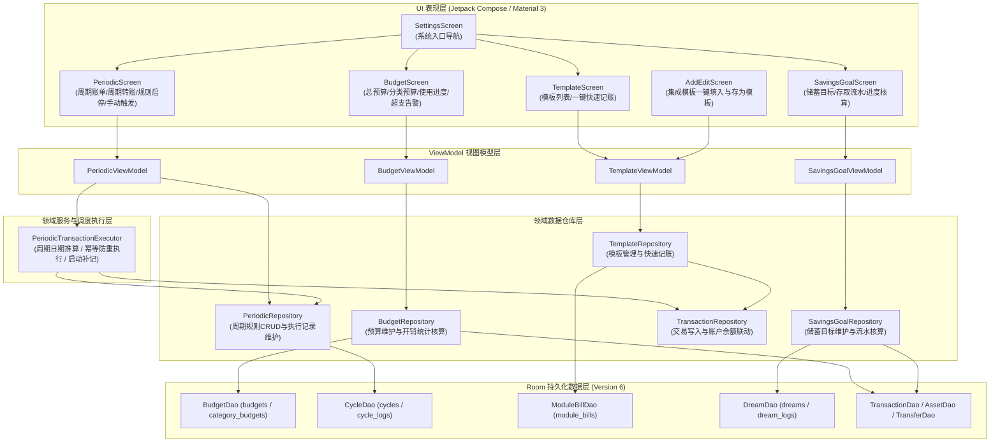

# T07 预算、周期、模板与储蓄目标实施计划方案

## 1. 目标描述与背景

### 1.1 阶段目标
在统一数据模型（Room 版本 5）与资产账户管理（T06）基础之上，完整实现执行单元 **T07：完成预算、周期、模板与储蓄目标**。
实现以下核心功能闭环：
1. **预算管理（Budget & CategoryBudget）**：实现账本维度的月度总预算与分类预算配置，实时统计当前支出、剩余预算与使用进度，支持超支预警与跨期滚存；
2. **周期规则与幂等执行器（Cycle / Periodic Transaction Executor）**：支持周期记账（日/周/月/月末最后一天/年/每N天/工作日）与周期转账，具备启动自动补记、确定的幂等键（dedupKey）防重机制，确保跨日跨月不漏记且绝不重复记账；
3. **账单模板（ModuleBill / Template）**：实现常用支出/收入/转账模板的快速创建、编辑与一键快速记账，打通记账页面的模板存取联动；
4. **储蓄目标（Dream / Savings Goal）**：实现储蓄愿望清单、目标金额与截止时间管理、存入与取出流水追踪、达成进度百分比与每日推荐储蓄额核算。
全量通过新增的 5 组独立 JVM 单元测试、Lint 0 错误、独立 Node.js SQLite 演练验证（`verify_T07_deliverables.js`）以及 `assembleDebug` 编译打包。

### 1.2 背景与物理基准
- **数据库升级**：当前数据库为 Room version 5，T07 将新增 `budgets`、`category_budgets`、`cycles`、`cycle_logs`、`module_bills`、`dreams`、`dream_logs` 7 张物理表，平滑升级至 Room version 6，导出 `6.json` schema 并编写 `MIGRATION_5_6`；
- **逆向证据依据**：严格对标一木记账 6.1.8 中已核实的 `Budget`、`CategoryBudget`、`BudgetSetting`、`Cycle`、`CycleDate`、`ModuleBill` 与 `Dream` 物理模型，常数字段与业务边界 1:1 精确映射；
- **长期关键决策遵守**：维持独立实体表架构、`Double` 精度存储、增量平滑迁移无损过渡、离线本地自治运行等 18 项共识原则。

---

## 2. 架构设计与状态机模型



### 2.1 状态机与核心业务计算公式

1. **预算核算状态机（Budget）**：
   - 预算总金额：$\text{TotalBudget} = \text{num} + \text{addNum}$；
   - 期间总支出（$\text{TotalExpense}$）：
     $$\text{TotalExpense} = \sum_{\text{tx} \in \text{transactions}} \text{tx.amount} \quad (\text{tx.bookId} = B \land \text{tx.transactionType} = \text{'EXPENSE'} \land \text{startTime} \le \text{tx.time} < \text{endTime} \land \text{notIntoBudget} \ne 1)$$
   - 剩余可用预算：$\text{RemainingBudget} = \text{TotalBudget} - \text{TotalExpense}$；
   - 预算使用率：$\text{UsageRatio} = \begin{cases} 0.0, & \text{TotalBudget} \le 0 \\ \frac{\text{TotalExpense}}{\text{TotalBudget}}, & \text{TotalBudget} > 0 \end{cases}$；
   - 超支判定：若 $\text{RemainingBudget} < 0$，触发超支警告状态；
   - 分类预算独立核算：按 $\text{parentCategoryId}$ 过滤，同理计算各项子分类预算的使用进度。

2. **周期记账幂等执行状态机（Cycle）**：
   - **发生日期推算**：
     - `MODE_EVERY_DAY (0)`：自上次发生日期起，每日推进 1 天；
     - `MODE_EVERY_WEEK (1)`：检查周几属于 `weekdays`（例如 `1,3,5` 表示周一、周三、周五）；
     - `MODE_EVERY_MONTH (2)`：匹配每月固定日 `monthDay`；若配置 `monthLast == 1`，自动取当月最后一天（针对 28/29/30/31 边界自适应）；
     - `MODE_EVERY_YEAR (3)`：匹配每年的 `month` 与 `monthDay`；
     - `MODE_EVERY_DAY_NUM (4)`：按固定步长间隔 $N$ 天；
     - `MODE_EVERY_WORK_DAY (5)`：周一至周五触发。
   - **幂等性判定与防重执行（Idempotency Guard）**：
     - 为每个周期发生实例生成全局确定性幂等键：
       $$\text{dedupKey} = \text{"cycle\_"} + \text{cycleId} + \text{"\_"} + \text{yyyyMMdd}$$
     - 执行前查询 `cycle_logs` 表，若存在匹配的 `dedupKey`，视为已入账，直接跳过；
     - 未入账时，在单一事务中完成：
       1. 插入 `TransactionEntity`（账单）或 `TransferEntity`（转账）；
       2. 联动调用 `AssetDao.updateBalance` 原子更新账户可用余额；
       3. 插入 `CycleLogEntity` 记录 `dedupKey`、生成业务 ID 与时间；
       4. 更新 `CycleEntity` 的 `lastAddTime`、递增 `addTimes`、推算写入 `nextTime`；
       5. 若配置了 `cycleTimes > 0` 且 `addTimes >= cycleTimes`，或当前时间超过 `cycleEndDate`，自动将 `end` 置为 1。

3. **账单模板快速记账（ModuleBill）**：
   - 模板包含常用收支/转账字段镜像；
   - 用户点击一键记账时，直接调用 `TransactionRepository.saveTransaction` 或 `createTransfer` 生成真实账单，或将参数完整回填至 `AddEditScreen` 记账键盘中进行金额确认。

4. **储蓄目标与进度核算（Dream）**：
   - 当前累计储蓄：$\text{CurrentSavings} = \text{startNum} + \text{addNum}$；
   - 目标达成进度：$\text{ProgressRatio} = \min\left(1.0, \frac{\text{CurrentSavings}}{\text{totalNum}}\right) \times 100\%$；
   - 剩余差额：$\text{RemainingAmount} = \max\left(0.0, \text{totalNum} - \text{CurrentSavings}\right)$；
   - 每日推荐储蓄：$\text{DailyTarget} = \begin{cases} 0.0, & \text{RemainingDays} \le 0 \\ \frac{\text{RemainingAmount}}{\text{RemainingDays}}, & \text{RemainingDays} > 0 \end{cases}$。

---

## 3. 拟变更文件清单与实施细节

### 3.1 实体、DAO 与数据库迁移层

#### [NEW] `app/src/main/java/com/nonen/Bookkeeping/data/entity/BudgetEntities.kt`
- 声明 `BudgetEntity`（表 `budgets`）与 `CategoryBudgetEntity`（表 `category_budgets`）。

#### [NEW] `app/src/main/java/com/nonen/Bookkeeping/data/entity/PeriodicEntities.kt`
- 声明 `CycleEntity`（表 `cycles`）与 `CycleLogEntity`（表 `cycle_logs`，包含唯一索引 `dedupKey`）。

#### [NEW] `app/src/main/java/com/nonen/Bookkeeping/data/entity/ModuleBillEntity.kt`
- 声明 `ModuleBillEntity`（表 `module_bills`）。

#### [NEW] `app/src/main/java/com/nonen/Bookkeeping/data/entity/DreamEntities.kt`
- 声明 `DreamEntity`（表 `dreams`）与 `DreamLogEntity`（表 `dream_logs`）。

#### [NEW] `app/src/main/java/com/nonen/Bookkeeping/data/db/PlanDaos.kt`
- 声明 `BudgetDao`、`CycleDao`、`ModuleBillDao`、`DreamDao` 及其查询、更新、删除接口。

#### [MODIFY] `app/src/main/java/com/nonen/Bookkeeping/data/db/AppDatabase.kt`
- 注册 7 个新实体；
- 数据库版本升级至 `version = 6`；
- 编写 `MIGRATION_5_6`：执行 7 张表的 `CREATE TABLE` 与必要索引建立；
- 暴露 `budgetDao()`、`cycleDao()`、`moduleBillDao()`、`dreamDao()` 抽象方法。

---

### 3.2 领域仓库与业务执行层

#### [NEW] `app/src/main/java/com/nonen/Bookkeeping/data/repo/BudgetRepository.kt`
- 职责：管理总预算和分类预算的查询、设定、滚存计算及开销聚合分析。

#### [NEW] `app/src/main/java/com/nonen/Bookkeeping/data/repo/PeriodicRepository.kt`
- 职责：管理周期账单/转账规则的 CRUD、启停控制、执行日志追踪与下次执行时间推算。

#### [NEW] `app/src/main/java/com/nonen/Bookkeeping/data/service/PeriodicTransactionExecutor.kt`
- 职责：核心执行引擎。提供 `executePendingCycles(now: Long = System.currentTimeMillis()): Int` 方法，在启动、前台唤醒或定时任务中自动补流入账，严密保证幂等防重。

#### [NEW] `app/src/main/java/com/nonen/Bookkeeping/data/repo/TemplateRepository.kt`
- 职责：模板增删改查、排序及从现有账单提取保存。

#### [NEW] `app/src/main/java/com/nonen/Bookkeeping/data/repo/SavingsGoalRepository.kt`
- 职责：储蓄目标增删改查、存入/取出流水记录、达成进度核算。

#### [MODIFY] `app/src/main/java/com/nonen/Bookkeeping/BookkeepingApp.kt`
- 在 `AppContainer` 中实例化并注入上述 4 个数据仓库与 `PeriodicTransactionExecutor`；
- 在 `onCreate` 中发起异步周期任务幂等执行扫描。

---

### 3.3 表现层与交互闭环

#### [NEW] `app/src/main/java/com/nonen/Bookkeeping/ui/screens/BudgetScreen.kt` 与 `BudgetViewModel.kt`
- 预算概览、进度指示环、分类预算卡片、月度预算编辑弹窗、超支警示标签。

#### [NEW] `app/src/main/java/com/nonen/Bookkeeping/ui/screens/PeriodicScreen.kt` 与 `PeriodicViewModel.kt`
- 周期列表、启用/暂停切换、立即触发按钮、新建/编辑周期规则弹窗（涵盖天/周/月/年/月末最后一天/步长选择器）。

#### [NEW] `app/src/main/java/com/nonen/Bookkeeping/ui/screens/TemplateScreen.kt` 与 `TemplateViewModel.kt`
- 常用模板卡片、一键入账操作、新建/编辑模板弹窗。

#### [NEW] `app/src/main/java/com/nonen/Bookkeeping/ui/screens/SavingsGoalScreen.kt` 与 `SavingsGoalViewModel.kt`
- 目标卡片列表（达成百分比、截止倒计时、每日推荐储蓄额）、存入资金弹窗、取出资金弹窗、明细流水列表。

#### [MODIFY] `app/src/main/java/com/nonen/Bookkeeping/ui/screens/AddEditScreen.kt` 与 `AddEditViewModel.kt`
- 顶部/操作栏增加“快捷模板”选择与“存为模板”按钮，打通记账与模板的双向交互。

#### [MODIFY] `app/src/main/java/com/nonen/Bookkeeping/ui/screens/SettingsScreen.kt`、`MainScreen.kt`、`AppNavHost.kt`
- 在设置页添加“预算管理”、“周期记账”、“账单模板”、“储蓄目标”4 个独立入口卡片；
- 在 `AppNavHost` 中注册 `Routes.BUDGET`、`Routes.PERIODIC`、`Routes.TEMPLATE`、`Routes.SAVINGS_GOAL` 4 条导航路由。

---

### 3.4 自动化验证与独立验收脚本

#### [NEW] `app/src/test/java/com/nonen/Bookkeeping/data/repo/BudgetRepositoryTest.kt`
- 验证月度总预算与分类预算聚合、开销实时计算、剩余预算与超支判定、滚存计算。

#### [NEW] `app/src/test/java/com/nonen/Bookkeeping/data/service/PeriodicExecutorTest.kt`
- 验证日/周/月/月末最后一天/年周期推算准确性；
- 验证历史断档跨期启动自动补记；
- 验证重复触发时幂等键生效，确保 0 重复入账；
- 验证转账与记账在周期触发下的账户余额变动一致性。

#### [NEW] `app/src/test/java/com/nonen/Bookkeeping/data/repo/TemplateRepositoryTest.kt`
- 验证模板保存、排序及一键生成账单。

#### [NEW] `app/src/test/java/com/nonen/Bookkeeping/data/repo/SavingsGoalRepositoryTest.kt`
- 验证储蓄目标创建、存入、取出、进度计算与推荐储蓄额。

#### [NEW] `app/src/test/java/com/nonen/Bookkeeping/data/db/Migration5To6Test.kt`
- 验证 Room 5 到 6 真实 SQLite 增量迁移升级，检验新表及索引完整性。

#### [NEW] `work/scripts/yimu-offline-rebuild/t07/verify_T07_deliverables.js`
- 独立 Node.js 验收脚本：
  1. 校验参考 APK SHA-256；
  2. 验证 T07 核心源码与测试物理存在；
  3. 通过 `node:sqlite` 操作真实 SQLite 数据库，全量演练：
     - 预算建立与开销统计；
     - 周期任务在跨日、月末与多次执行下的幂等入账与资金联动；
     - 账单模板应用；
     - 储蓄目标存取与进度核算。
- 自动化输出完整验证日志至 `work/logs/yimu-offline-rebuild/T07-20261018-01/verification_result.json`。

---

## 4. 验证计划

### 4.1 自动化测试执行命令
```powershell
# 1. 运行 T07 专职单元测试与全量 JVM 单元测试（预期全量通过）
.\gradlew.bat :app:testDebugUnitTest

# 2. 运行 Android Lint 静态分析（预期 0 错误）
.\gradlew.bat :app:lintDebug

# 3. 运行 T07 独立综合演练验收脚本
node work/scripts/yimu-offline-rebuild/t07/verify_T07_deliverables.js

# 4. 回归前序全部阶段独立验收脚本（T01-B 至 T06 全部退出状态 0）
node work/scripts/yimu-offline-rebuild/t06/verify_T06_deliverables.js
node work/scripts/yimu-offline-rebuild/t05/verify_T05_deliverables.js
node work/scripts/yimu-offline-rebuild/t04/verify_T04_deliverables.js
node work/scripts/yimu-offline-rebuild/t03/verify_T03_deliverables.js
node work/scripts/yimu-offline-rebuild/t02/verify_T02_deliverables.js
node work/scripts/yimu-offline-rebuild/financial/verify_T01_B_deliverables.js

# 5. 编译打包生成最终 APK
.\gradlew.bat :app:assembleDebug
```

### 4.2 人工走查与验收标准
- 编译生成 `app-debug.apk`；
- 打开预算管理：能设定当月总预算与分类预算，支出后进度条实时变化，超支标红告警；
- 打开周期记账：能新建房租月度账单（设定每月 15 号或月末最后一天），手动触发或应用启动时自动补进入账，账户余额正确扣减；
- 打开账单模板：一键保存“咖啡 15元”模板，在记账页一键选择并入账；
- 打开储蓄目标：新建“旅游基金”（目标 5000 元），存入 1000 元后进度显示 20%，推荐每日储蓄额准确计算。
