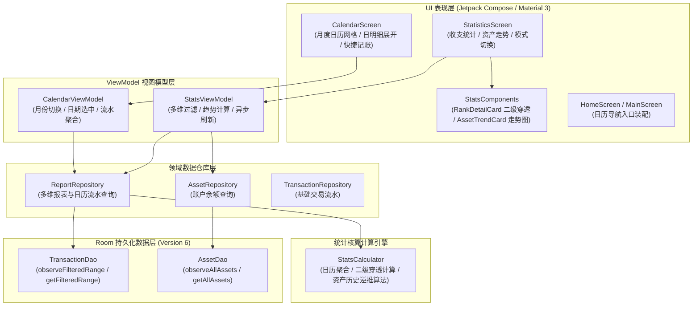

# T08 报表与统计核算实施方案

## 1. 目标描述与背景

### 1.1 阶段目标
在预算、周期、模板与储蓄目标（T07）基础之上，完整实现执行单元 **T08：完成五个主页与统计核算**。
实现以下核心功能闭环：
1. **收支日历视图（CalendarScreen & CalendarViewModel）**：月度日历网格呈现、单日收支红绿圆点标识、单日流水快速展开与单日汇总、支持日历界面快速记账与月份切换；
2. **多维统计分析（StatisticsScreen & StatsViewModel 增强）**：期间（日/周/月/年/自定义）、分类（支出/收入）、账本、账户过滤聚合，呈现总支出、总收入、结余与日均收支；
3. **分类二级穿透下钻（SubCategory Breakdown）**：一级分类排名与二级分类构成占比展示，点击一级分类卡片展开二级明细与单笔交易；
4. **资产变动趋势曲线（Asset Trend Analysis）**：以当前真实账户余额为基准，利用逆推算法构建历史资产/负债/净资产每日走势，并采用 Canvas 平滑绘制曲线。

全量通过新增的独立 JVM 单元测试（`CalendarStatsTest`、`AssetTrendTest`、`ReportRepositoryTest`）、Lint 0 错误、独立 Node.js SQLite 演练验证（`verify_T08_deliverables.js`）以及 `assembleDebug` 编译打包。

### 1.2 背景与模型基准
- **模型扩展**：在 `StatsModels.kt` 扩充 `CalendarDaySummary`、`SubCategoryStat`、`CategoryDetailStat`、`AssetTrendPoint` 领域模型，扩展 `StatsQuery` 支持多维筛选；
- **算法设计**：在 `StatsCalculator.kt` 增加 `computeCalendarMonth`、`computeSubCategoryBreakdown` 以及 `computeAssetTrend`；
- **数据仓库**：新建 `ReportRepository.kt`，封装对 `TransactionDao` 和 `AssetDao` 的聚合统计查询；
- **长期关键决策遵守**：保持原有 20 项架构决策框架，严禁引入云端计算，保持本地毫秒级纯纯离线聚合。

---

## 2. 架构设计与数据流

---

## 3. 核心计算算法与设计决策

### 3.1 资产变动趋势逆推算法
以当前时刻各个真实资产账户的实时余额 $\text{current\_balance}(A)$ 为可靠锚点：
对于任意历史日期节点 $t$（取该日 23:59:59.999 毫秒为时间上限）：
$$\text{balance}_t(A) = \text{current\_balance}(A) - \sum_{tx.timestamp > t.\text{end}, tx.assetId == A} tx.amount$$
根据账户类型将推算余额映射为资产或负债：
- 资金/资产账户：余额即为该账户资产；
- 信用卡账户：当前欠款负债 = $\text{totalQuota} - \text{balance}_t(A)$；
- 借入借出账户：依据原应用负债与资产口径核算；
- 历史净资产 = $\sum \text{Asset}_t - \sum \text{Debt}_t$。
该算法保证任意时间区间的资产趋势曲线期末值与当前资产总览严格一致，历史波峰波谷精准反映每一笔实际交易。

### 3.2 二级分类穿透与聚合
在一级分类聚合统计基础上，对一级分类下属交易记录按照 `subCategory` 进行二级直方图聚合，计算二级分类支出金额与一级分类总支出的占比百分比，并在 UI 卡片中提供平滑展开与折叠下钻交互。

---

## 4. 验证与交付标准

1. **JVM 单元测试**：
   - `CalendarStatsTest`：验证跨月、闰月与单日收支汇总；
   - `AssetTrendTest`：验证资产逆推算法精确性与负债口径计算；
   - `ReportRepositoryTest`：验证多维过滤条件组合查询；
   - 适配全部既有测试中的 DAO Mock 实现。
2. **静态代码分析**：`lintDebug` 0 错误 0 告警。
3. **独立脚本演练**：`verify_T08_deliverables.js` 真实 SQLite 演练退出状态为 0，前序 T01-B 至 T07 演练全部为 0。
4. **编译打包**：`assembleDebug` 构建生成有效 APK。
