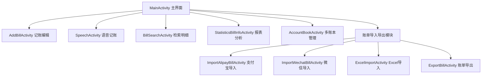

# base.apk 静态逆向工程分析报告

## 1. 基础信息与构建属性

| 属性名称 | 属性值 |
| :--- | :--- |
| **目标文件名** | `base.apk` |
| **文件大小** | 38,342,884 字节（约 36.56 MB） |
| **SHA-256 校验码** | `e5ec945aa290c6f66fcd43c3f4307eebc5c7796d188e41895dcdf7fed599f8fd` |
| **应用名称** | 一木记账（Yimu App） |
| **应用包名** | `com.wangc.bill` |
| **版本代码 (VersionCode)** | `378` |
| **版本名称 (VersionName)** | `6.1.8` |
| **编译 SDK 版本** | API 36 |
| **目标运行版本 (Target SDK)** | API 36 |
| **最低兼容版本 (Min SDK)** | API 26（Android 8.0 Oreo） |
| **解析类总数** | 13,743 |
| **资源项总数** | 3,244 |
| **主要架构** | ARM64 (`arm64-v8a`) |

---

## 2. 应用入口与组件架构

### 2.1 启动类与主控制器
- **Application 类**：`com.wangc.bill.application.MyApplication`，负责第三方服务初始化、数据库映射初始化、全局缓存管理。
- **主启动 Activity**：`com.wangc.bill.activity.MainActivity`，负责主界面容器、底栏导航、账单流水呈现。
- **桌面图标动态切换**：在清单文件中配置了 42 个 `activity-alias`（均指向 `MainActivity`），支持运行时切换应用图标样式（卡通、像素、彩色、纯文字、节气节日如端午与清明、暗黑风格）。

### 2.2 核心业务 Activity

### 2.3 四大组件分布汇总
- **Activity 总数**：158 个（含 42 个图标别名与第三方 SDK 界面）。
- **Service 总数**：9 个（包含快捷设置磁贴服务 `QuickSettingService`、微件数据更新服务 `BillWidgetService`、`CalendarWidgetService`、IPC 服务 `MessengerUtils.ServerService`）。
- **BroadcastReceiver 总数**：11 个（主要用于 10 类桌面微件的定时触发与广播更新）。
- **ContentProvider 总数**：5 个（包括自研数据提供器 `com.wangc.bill.content.MyContentProvider`、文件分享提供器 `FileProvider`、初始化器 `InitializationProvider`）。

---

## 3. 核心功能实现深度分析

### 3.1 本地自然语言解析引擎（NLP Engine）
- **核心类**：`com.wangc.bill.nlp.nlp.a`、`com.wangc.bill.nlp.nlp.c`
- **解析机制**：
  1. 采用离线语法规则与序列化模型相结合的机制。应用从 `assets/TimeExp.m` 载入预训练的时间识别模型，能够将口语化表述（如“昨晚七点半”、“上周五下午”）自动转换为标准时间戳。
  2. 结合 `assets/classification-model.ser` 进行消费类别预测，分析用户输入的消费项目（如“火锅”、“打车”、“超市”），并自动映射至系统预设的父子收支分类体系。
  3. 当本地解析置信度不足时，支持通过 HTTP 接口 `https://ai.yimubill.com` 请求云端大模型与规则库进行语义分析纠错。

### 3.2 智能语音识别记账
- **核心组件**：`SpeechActivity` 与 `SpeechAppWidget`
- **技术组合**：
  - 本地动态库：`lib/arm64-v8a/libBaiduSpeechSDK.so`
  - 语音活动检测引擎：`lib/arm64-v8a/libvad.dnn.so`
  - 授权文件：`assets/aip.license`
- **业务流程**：启动录音监听用户说话，通过 VAD 算法自动截取有效语音帧，送入百度语音识别引擎解析为文本，随后传入 NLP 解析器提取交易金额、支付账户与分类，直接生成记账模型 `BillInfo` 供用户快速保存。

### 3.3 离线数据库与资产管理
- **ORM 框架**：采用 `LitePal`（数据库名称 `Custom`，架构版本 `2707`）。
- **实体表结构（共 84 张业务表）**：
  - **记账核心**：`Bill`（账单主体）、`ParentCategory`/`ChildCategory`（收支分类）、`Tag`（自定义标签）、`AccountBook`（独立多账本）。
  - **资产理财**：`Asset`（资产账户）、`AssetFixedDeposit`（定期存款）、`StockAsset`/`StockInfo`/`StockPrice`（股票基金持仓与估值）、`Loan`/`LoanInterest`（借贷分期）。
  - **自动化规则**：`AutoApp`/`AutoSetting`/`AutoTag`/`AutoAssetMap`（支持无障碍与通知监听模式下的自动记账映射）。

### 3.4 网络服务与云端接口体系
反编译分析提取的主要服务端交互地址如下：

| 服务类别 | 交互地址 / 域名 | 功能说明 |
| :--- | :--- | :--- |
| **主业务接口** | `https://yimuapp.com:8082/bookkeeping/` | 用户鉴权、账单多端同步、账本成员协同 |
| **辅助备用接口** | `https://yimubill.com:8083/yimu/` | 备用服务与数据更新通道 |
| **AI 识别接口** | `https://ai.yimubill.com` | 票据识别、云端复杂 NLP 语义分析 |
| **静态资源服务** | `https://static.yimubill.com` | 类别图标、主题壁纸下载 |
| **行情数据接口** | `https://stock.finance.sina.com.cn/fundInfo/api/openapi.php/` | 基金与股票实时净值查询接口 |
| **安全签名支持** | `lib/arm64-v8a/libapisecurity-lib.so` | 本地 C++ 编译层，负责 API 鉴权加签与反抓包防护 |

---

## 4. 权限使用与安全隐私评估

### 4.1 敏感权限列表
应用在 `AndroidManifest.xml` 中声明了 30 项权限，其中核心敏感权限包括：
- `RECORD_AUDIO`：用于语音记账录音输入。
- `CAMERA`：用于拍照记账与票据 OCR 扫描。
- `READ_EXTERNAL_STORAGE` / `WRITE_EXTERNAL_STORAGE` / `MANAGE_EXTERNAL_STORAGE`：用于本地账单备份导入导出及图片存储。
- `ACCESS_FINE_LOCATION` / `ACCESS_BACKGROUND_LOCATION`：用于记账时记录地理位置。
- `USE_BIOMETRIC` / `USE_FINGERPRINT`：用于应用启动密码锁与资产安全保护。
- `SYSTEM_ALERT_WINDOW`：用于桌面悬浮球与快捷悬浮记账窗口。

### 4.2 潜在安全隐患点
1. **ContentProvider 暴露风险**：
   - 组件名称：`com.wangc.bill.content.MyContentProvider`
   - 配置属性：`android:exported="true"`，且**未声明任何权限保护**。
   - 反编译分析显示，其 `query()` 方法直接返回内部数据游标，可能导致同设备其他恶意应用越权读取本地账本隐私数据。
2. **IPC 服务暴露**：
   - 组件名称：`com.blankj.utilcode.util.MessengerUtils.ServerService`
   - 配置属性：`android:exported="true"`，通过特定 action 即可绑定服务进行进程间通信。
3. **明文流量传输配置**：
   - 清单中设置了 `android:usesCleartextTraffic="true"`，允许使用 HTTP 进行明文通信，存在中间人劫持风险。
